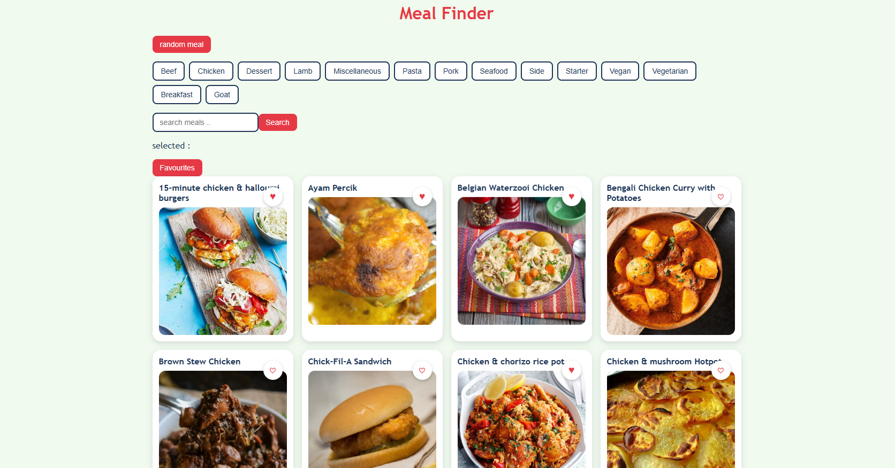

# Meal Finder

A React app to search recipes, filter them by category and save your favourite meals.

**Live demo:** [link](https://meal-finder-pi-pied.vercel.app/)

## Features
- Search meals by name
- Filter by category
- Recipe details with ingredients, measures and instructions
- Random meal button
- Favourites: click the heart on a card, and switch to a favourites-only view
- Favourites are saved in localStorage, so they stay after a page reload
- Responsive grid: 4, 2 or 1 columns depending on the screen width
- Loading, error and empty states

## Tech Stack
React, Vite, CSS, TheMealDB API

## How to Run
1. Clone the repo
2. `npm install`
3. `npm run dev`

## What I Learned
- Building the UI from small components and props
- Managing state with useState
- Fetching data with useEffect
- Rendering lists with keys
- Handling loading, error and empty states
- Splitting App.jsx into components (SearchBar, CategoryFilter, MealList, MealCard, MealDetails)
- Saving data with localStorage, using JSON.stringify and JSON.parse
- Showing one list or another with a conditional (`showFavs ? favs : meals`)
- Responsive layout with CSS Grid and media queries